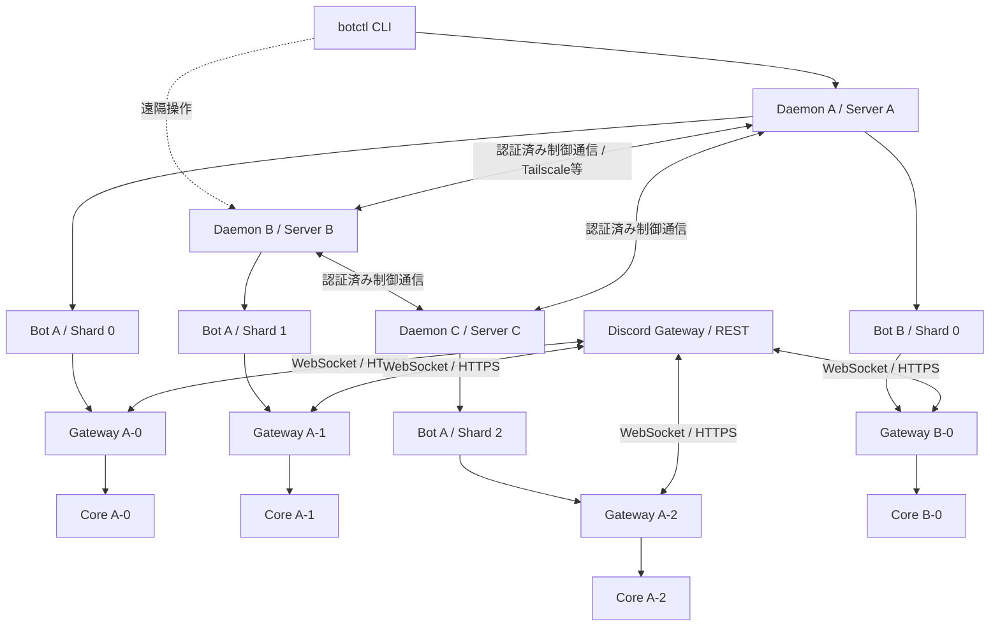
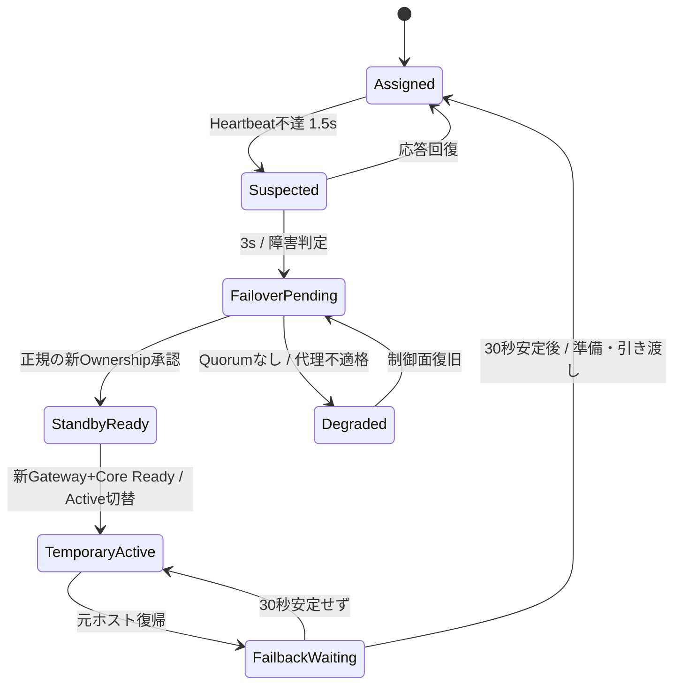
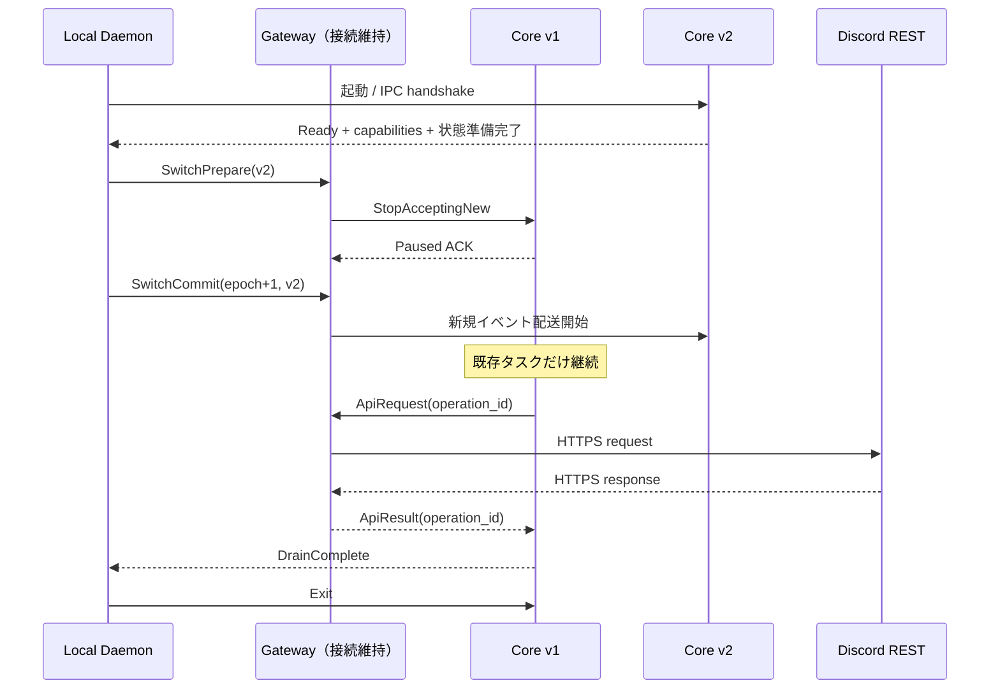
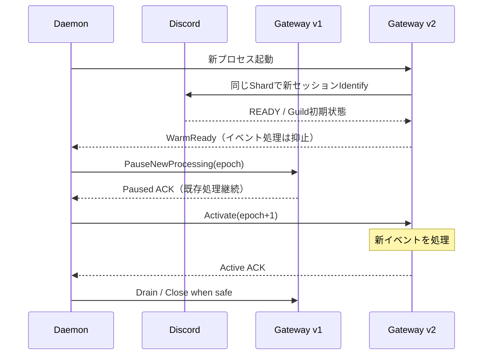
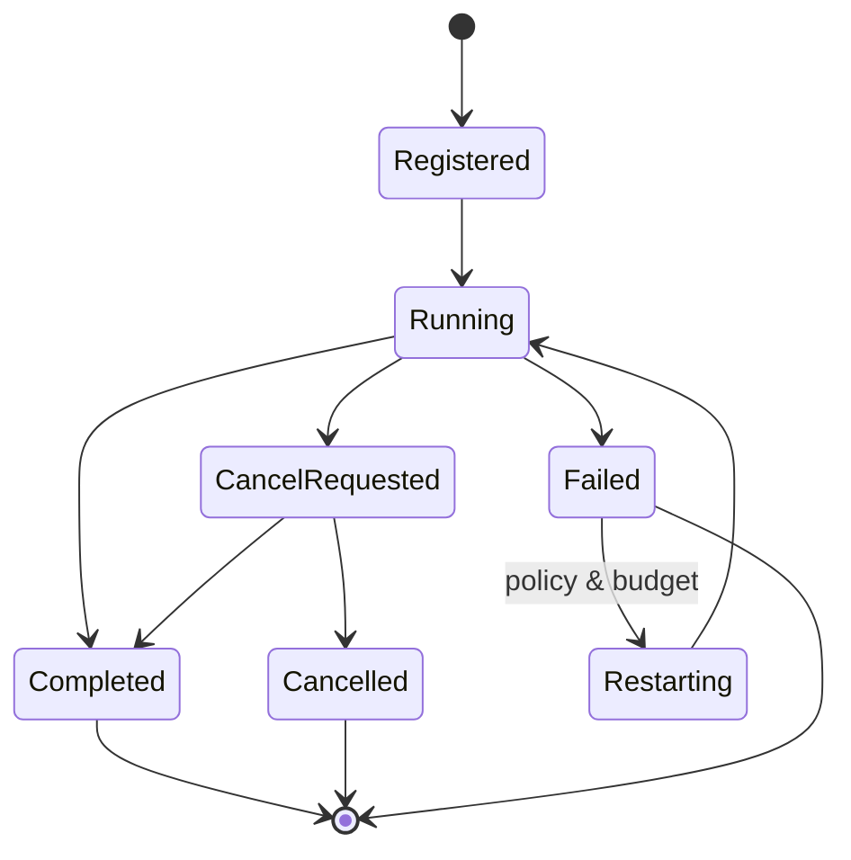

# Rust Discord Bot Framework — アーキテクチャ・実装仕様書 v1.0

> **目的**：この文書だけを読めば、Codexが既存リポジトリを調査し、設計を尊重しながら実装・テスト・性能検証・ドキュメント整備まで進められること。<br>
> **作成日**：2026-11-11<br>
> **状態**：**設計ベースライン**。会話で合意した要件は固定し、まだ実測・検証されていない実装案には「採用案」「要検証」を付す。<br>
> **重要**：ここに掲載する独自APIのコードは**要求する開発者体験のサンプル**であり、現時点で動作確認済みのライブラリAPIではない。Codexは実装したAPIでサンプルを実際にコンパイルさせること。

## 0. 先に読む：このプロジェクトで絶対に崩さない方針

1. **開発体験を最優先する**。`discord.py` の「書きやすい・読みやすい・理解しやすい」を参考にし、小さなBotは短く、大規模Botは機能ごとに整理して美しく保つ。性能のためだけに利用者へ大量の定型コードを強制しない。
2. **Rust + Tokio + Twilightを基本**とする。対応OSはLinux（Ubuntu）のみ。Windowsはサポート外（2026-11-13決定。Windows固有コードは残すが保証・CI対象としない）。本番性能と安定性はLinuxを最優先。
3. **Dockerのような `botctl` CLI + 常駐Bot Daemon**。最初から複数Botの名前／IDによる管理に対応する。Daemonは各サーバーに配置し、Tailscale等を通じて状態取得・遠隔操作・協調管理できる。
4. **Shard単位で独立したGatewayとCoreを配置**する。平常時の原則は「1 Shard = 1 Gateway実行単位 + 1 Active Core実行単位」。同じBotの複数Shardは異なるサーバーに配置できる。これは「1 Botが1 Gatewayプロセス」という制限ではない。
5. **Core更新はGateway接続を切らずにホットスワップ**。旧Coreは新規受付をやめ、実行中の仕事と送信結果の確認を終えてから終了する。
6. **Gateway更新も新旧GatewayのWebSocket並行接続を使った切替**を採用する。新Gatewayが準備できてからActiveを切り替え、旧Gatewayは新規処理を止める。Discordの接続断が必要な方式に最初から固定しない。
7. **Shard配置は設定主導で厳密に管理**。各ローカルDaemonが担当Shardを制御し、サーバー障害時は生存サーバーへ自動引き継ぎ、復旧後は元の配置へ自動返却する。
8. **障害検知目標3秒、復旧後の安定確認30秒**を初期値にする（設定変更可能）。3秒は**検知**であってDiscord再接続まで含めた復旧完了時間の保証ではない。
9. **Cogは任意**。通常の関数だけでも開発可能とし、大規模Bot向けにCog相当の機能分割・状態共有を提供する。**ハイブリッドコマンド（スラッシュ＋プレフィックス）は第一級機能**。
10. コマンドは**属性マクロ方式**を基本にする。ビルダー方式やコマンドをTOMLへ二重記述する方式を通常の開発者APIに強制しない。コマンド自動収集も使いやすさのために採用案とする。
11. **オーバーヘッド、実装・保守コスト、安定性、メモリ使用量を実測で比較**する。抽象化や外部依存を無目的に増やさない。
12. **「無停止」「完全無欠落」「Exactly Once」を未検証で宣言しない**。達成する保証、境界条件、既知の制約、検証結果を区別する。

---

## 1. 提供価値と成功条件

### 1.1 目標

- 開発者は数行で `ping`、イベントハンドラー、ハイブリッドコマンドを書ける。
- 機能を増やしても、Cogs/モジュール、Context、型付き状態注入、共通エラー処理で見通しを維持する。
- Bot管理者は `botctl status` / `update` / `rollback` / `logs` / `doctor` によりBot名またはIDで管理できる。
- 同一BotのShardを複数ホストへ分散し、Shard単位で障害隔離・ローリングアップデートを行える。
- Core更新時にWebSocketを保持し、旧Coreの処理と応答を安全に完了する。
- Gateway更新時に新旧WebSocketを並行確立して切り替える。
- 他ホスト障害に対する自動フェイルオーバー／フェイルバックを備える。
- 通常のイベント処理は各Shardのローカル経路を優先し、管理用通信やDBへイベント単位で問い合わせない。

### 1.2 非目標・制約

- BEAM/ElixirのVM、プロセスモデル、コードローディング全体の再現はしない。取り入れるのは**世代交代・Supervisor的な監視・Graceful Draining**の考え方。
- Rustで実行中のFutureを別プロセスのメモリへ丸ごと移す機能は作らない。
- すべてのDiscord Dispatchに一意のイベントIDが存在するとは仮定しない。
- すべてのShardを常時ホットスタンバイさせることは強制しない。可用性とIdentify/メモリ消費は設定で選ぶ。
- Gatewayの並行接続だけで、グローバルに厳密なイベント順序・欠落ゼロ・副作用の一回限りの実行が保証されるとはしない。
- OS障害・ネットワーク分断下で**安全な自動引き継ぎ**を要求する場合、ローカルメモリだけでは解決できないことを認める。通常経路にリモートロックを追加しない設計で安全性を確保する。

### 1.3 保証レベルの用語

| 用語 | この仕様での意味 |
|---|---|
| **Core接続維持更新** | Coreを切り替えても、そのShardのGateway WebSocketセッションを維持 |
| **Gateway並行切替** | 旧新WebSocketの並行稼働後にActive権限を移す。ユーザー影響の低減が目的 |
| **Graceful Draining** | 旧世代への新規配送を停止し、管理対象の既存仕事を待って終了 |
| **At-least-once配送（限定）** | 明示的にACK/再配送を実装した**内部IPC**について、保持可能範囲内で再配送する。アプリ副作用のExactly Onceを意味しない |
| **排他Active** | 同一 `(bot_id, shard_id)` の新規処理を担う論理的Active世代は原則1つ。旧世代の許可済み仕事の完了は別 |

---

## 2. 全体アーキテクチャ



**実装上の単位**：`Bot` は論理上の管理対象。`ShardRuntime` はShard単位の独立した実行・配置・更新・復旧単位。通常時はGatewayプロセス1つ＋Coreプロセス1つ、更新期間のみ新旧が並存する。**1プロセスに複数Shardを詰め込むことを必須の構造にしない**。

### 2.1 コンポーネントと責務

| コンポーネント | 責務 | 持たせないもの |
|---|---|---|
| `botctl` | 管理APIへ接続し、表示・操作・確認を行う。CLI終了でBotへ影響しない | Discord WebSocket本体、Coreの実行状態 |
| ローカル `botd` | 自ホストのBot/Shard起動・停止・監視、更新制御、設定、ログ、他Daemon連携 | Discordコマンドの業務ロジック |
| Daemon間制御層 | シャード配置・担当世代・フェイルオーバーの合意、ステータス共有 | 各Discordイベントの逐次処理 |
| `gateway-host` | Discord WebSocket、Shardセッション、Heartbeat/Resume、イベント入口、REST送信依頼、最小キャッシュ、IPC | Cog、業務判断、長期ジョブ |
| `bot-core` | コマンド・イベントRouter、Cog、Context、Task Manager、Supervisor、業務処理 | Discord WebSocketの所有 |
| 共有 `protocol` | IPCメッセージ、識別子、互換性、認証付きHandshake | 起動処理やアプリ固有のロジック |
| `state` API | 再起動を跨ぐ業務状態・View状態・ジョブチェックポイントを型付きで保存 | Gateway heartbeatへのブロッキング |

`Worker` は初期段階では**Core内の管理対象タスク／機能**を指す。別OSプロセスにする設計は必要になるまで強制しない（プロセス数・IPC・ビルドコストを抑える）。

### 2.2 IDと参照

- `node_id`：永続なホスト識別子。表示名と別に内部IDを持つ。
- `bot_id`：永続なBot識別子。Bot名変更・更新・Shard移動で変えない。
- `bot_name`：利用者が指定。管理スコープ内で一意。CLIは名前／完全ID／一意なIDプレフィックスを受け付ける。
- `shard_id` と `total_shards`：DiscordのIdentifyに渡す組。`shard_id` は `0 .. total_shards-1`。
- `generation_id`：CoreまたはGatewayの**起動世代**。ソフトウェアのバージョン文字列とは区別する。
- `ownership_epoch`：ShardのActive権限変更のたび増える世代。古い制御命令を拒否する。
- `request_id`：Gateway↔Core間の一要求を対応付ける内部ID。
- `operation_id`：Discord REST API呼び出しと応答を対応付けるID。
- `event_key`：重複排除可能なDiscordイベントにだけ設定する意味的なキー（例：Interaction ID）。すべてのイベントにあるわけではない。

---

## 3. 技術スタック（採用案）

| 分野 | 採用案 | 補足 |
|---|---|---|
| 言語・実行 | Rust stable / Tokio | Linuxでのパフォーマンスを最優先（Windowsはサポート外） |
| Discord Gateway | `twilight-gateway` | 最新の互換バージョンをそろえて固定。Shard/Resumeを活用 |
| Discord REST/model | `twilight-http`, `twilight-model` | Coreへトークンを渡さずGateway経由で操作 |
| Discordキャッシュ | `twilight-cache-inmemory`（選択的） | 全メンバー・全メッセージの無条件保存はしない |
| 属性マクロ | `syn`, `quote`, `proc-macro2` | `framework-macros` クレート |
| コマンド自動収集 | `inventory`（第一候補） | リンク対象に含まれる静的コマンドのみ。衝突検証と並び順固定が必須 |
| CLI | `clap` | Docker風のサブコマンド |
| ローカルIPC | `interprocess` + Tokio | Linux: Unix Domain Socket、Windows: Named Pipe相当 |
| 制御プレーン・通信 | Tokio TCP + rustls、Tailscale推奨 | Tailscaleに依存しない抽象化。mTLS等でノードを相互認証 |
| メッセージ | `serde` + `rmp-serde`（採用案） | バージョン付き、長さ制限、フレーム化。JSONはデバッグ用 |
| タスク管理 | `CancellationToken`, `JoinSet`/`TaskTracker` | 子タスクの追跡と終了待機 |
| ログ | `tracing`, `tracing-subscriber` | Bot/Shard/世代/要求IDの相関 |
| ローカル永続化 | SQLite（例：`rusqlite`、専用タスク） | Daemon設定スナップショット、再起動記録、監査履歴。DiscordイベントのHot Pathで同期I/O禁止 |
| 複数ノード合意 | **成熟したRaft実装（候補：`openraft`）** | 3ノード以上で使う制御プレーンの採用案。自作Raftは禁止。APIの互換・保守リスクを確認 |
| テスト | `cargo test`, `trybuild`, `tokio::test`, 統合テスト | マクロのコンパイルエラー、IPC、障害注入、更新実験を含む |

**バージョン運用**：Twilightは`twilight`メタクレートだけを依存に加えても機能しない。必要な各クレートを同一の互換系統で選択し、`Cargo.lock` に固定する。採用前に`cargo search`/docs.rsで現行の互換性を検証する。`openraft` は1.0未満のAPI変更にも注意。

**Poiseとの差別化**：Poiseはすでに属性マクロでスラッシュ／プレフィックスを一つにまとめられる。**「ハイブリッドだけ」では独自性はない**。主要な差別化は `Gateway/Coreの分離・世代交代・Shard単位の分散運用・管理CLI・Task Supervisor` と、これらを隠蔽した読みやすい開発者APIに置く。

---

## 4. CLI・Daemonの仕様

### 4.1 CLI（実装すべき最低限）

```bash
botctl ps                            # 全Bot一覧。Docker風の別名: botctl status
botctl status mybot                  # 名前・完全ID・一意なID接頭辞を受け付ける
botctl inspect mybot                 # 詳細状態 JSON も選択可能
botctl create --name mybot --token-env DISCORD_BOT_TOKEN --shards auto
botctl start mybot
botctl stop mybot                    # Graceful stop
botctl shutdown mybot                # stopのエイリアス
botctl restart mybot                 # Gatewayを含む再起動
botctl reboot mybot                  # restartのエイリアス
botctl update mybot --component core # 既定はCore更新
botctl update mybot --component gateway
botctl update mybot --component all --rolling
botctl rollback mybot
botctl logs mybot --follow
botctl doctor mybot
botctl shards mybot                   # Shardと配置の一覧
botctl nodes                         # 接続可能なDaemonの一覧
botctl config validate --file config.toml
```

- `update` は**事前ビルド済みの署名／ハッシュ確認可能な新成果物**または明示した実行ファイルパスを受け取る。既定では勝手に`git pull`や任意コード実行をしない。
- 危険な操作（force stop、手動ownership切替、データ消去）は明示オプションと確認を要求する。TTYなしでは `--yes` を別途要求する。
- コマンド成功時は必ず結果（最終世代、対象Shard、所要時間、失敗Shard）を返し、失敗を成功と偽らない。
- 同名のBotや複数一致するIDプレフィックスはエラー。Bot名はUnicode可だが、識別子用スラッグは安全な文字制約を設ける。
- `--json` により機械可読な出力、非ゼロExit Code、`--timeout` と操作IDによる再照会を提供。

### 4.2 Daemonの動作

- **各ホストに1つのローカルDaemon**。複数Bot・複数Shardの子プロセスを管理する。別ホストのDaemonを1つの中央Daemonに依存させない。
- Linux本番は`systemd` unit、起動時再開、Watchdog連携、適切な権限分離。Windowsはコンソール/開発用バックグラウンド起動（Windows Service化は任意追加）。
- BotプロセスがDaemonより先に落ちても障害隔離し、Daemonのみが落ちても既存Gateway/Coreが原則として即時強制終了しないよう、プロセス所有と終了ポリシーを明示する。
- 再起動後に子プロセスの実態を照合する（PID再利用対策として起動世代・プロセス開始時刻・IPC認証を確認）。孤児を誤って別Botとして採用しない。
- 管理用ネットワーク障害がDiscord通信やGatewayのHeartbeatをブロックしない。

### 4.3 管理APIとセキュリティ

- ローカル：Unix socket / Named Pipe、OSユーザー権限で操作を制限。
- 遠隔：Tailscale等の私設網で接続。**私設網であることだけを認証とみなさず**、ノードID確認＋mTLSまたは同等の相互認証、RBAC（閲覧・更新・管理）を行う。
- 初期設定は外部公開bindなし。設定があっても平文遠隔TCPの管理コマンドを禁止。
- すべての更新／フェイルオーバー／手動操作に監査ログを残す。Bot Token、Interaction Token、IPC秘密情報をログに記録しない。

---

## 5. Sharding・配置・自動フェイルオーバー

### 5.1 基本ルール

- BotのShard総数は `GET /gateway/bot` の推奨値を自動取得するモードと、明示的な固定値の両方を提供。
- 同一BotのすべてのShardは同じ `total_shards` で整合させる。Shard割当は `(guild_id >> 22) % total_shards`。Guild IDのない一部イベントはShard 0へ届く。[^discord-gateway]
- 各Shardの**優先配置ノード**と**代理候補の優先順**は設定で制御できる。自動配置も許可するが、利用者の明示的な配置制約を破らない。
- Shard数変更はGuild割当の変化を伴うため、通常の単一Shard更新とは分離した計画的な世代交代操作とする。
- `Identify` はDiscordの`session_start_limit`、`max_concurrency`、Identify間隔を守る。全ホストに分かれたShardも**Bot単位**で予算管理する。[^discord-gateway]

### 5.2 フェイルオーバー設定の初期値

| パラメータ | 初期値 | 意味 |
|---|---:|---|
| Daemon間ヘルス通信 | 500ms | 軽量な生存・状態確認 |
| 障害疑い | 1.5秒 | Suspicious。まだ所有権を移さない |
| 障害判定目標 | 3.0秒 | 引き継ぎ手順の開始判定 |
| 安定復旧待機 | 30秒 | 自動フェイルバック前の安定確認 |
| 代理候補 | 設定による | 最優先ノードが不適格なら次候補 |
| 二重Active防止 | **必須** | 引き継ぎ開始時のみ制御プレーンで権限を確定 |

**注意：3秒のHeartbeat喪失だけでは、対象ホストのDiscord接続が死んだとは限らない。** ネットワーク分断時に二重Activeを避けるには、旧担当がActiveを継続できない条件と、新担当がActiveになれる条件を一致させる必要がある。

### 5.3 採用する権限モデル

- 各Daemon内部は**単なるメモリ内のActive状態／世代番号**で高速に配送を判定し、普段のイベントでDB・Raft・遠隔Daemonへロック問い合わせをしない。
- **同一Daemon内の新旧Gateway切替**：Daemonが権限と世代を管理し、IPCで`Prepare`→`PauseOld ACK`→`ActivateNew ACK`→`DrainOld`。プロセス間の普通の排他制御でよい。
- **別ホストへの自動引き継ぎ**：複数Daemon間で所有権の競合が起き得るので、Shard単位の`ownership_epoch`を持ち、**クォーラムで承認された所有権の更新**を採用案とする。Raftライブラリ等を**管理制御だけ**で使う。不要なアプリDBロックをHot Pathへ持ち込まない。
- 旧担当が制御面を失った場合でも永遠にActiveにならないよう、**ローカル期限付き権限（lease）と停止watchdog**を持つ。時計差／処理遅延／lease更新の安全性を実装・テストで確認する。承認前に新担当が勝手にActiveへ昇格しない。
- 構成上クォーラムを作れないときは安全を優先して自動昇格しない。2台構成で片方が故障しても自動引き継ぎが必要なら第三の投票ノード（witness等）を用意する。
- 制御層は`OwnershipCoordinator` traitで分離し、`StandaloneCoordinator`（単機・冗長化なし）と`QuorumCoordinator`（分散配置時）を用意する。**自前で分散合意アルゴリズムを書き始めない**。
- これにより**正常な切替時の余計な外部通信は最小限**にできる。ただし任意のネットワーク分断・OS停止・停止遅延下で二重副作用が絶対に起きないと保証するのは別問題。Epochと冪等化を使う。

### 5.4 障害から復旧まで



- **Failover**：担当ホスト障害→3秒目標で検知→所有権確定→代理ホストのShardを起動／Ready確認→Active。
- **Failback**：元ホストの復帰→30秒の安定確認→元ホストの新Gateway/Coreを準備→所有権切替→旧代理をDraining→終了。
- **防振**：障害が繰り返される場合は指数バックオフ／クールダウン。復帰直後の往復移動を抑制。
- **Standby方式**：`cold`（省メモリ・Identify必要）／`warm`（Core事前起動）／`hot_gateway`（同ShardでWebSocket事前接続、消費資源大）を設定で選べる。初期値は`cold`を推奨、厳しい復旧時間が必要なShardのみ温存方式を使う。
- **留意**：ホストが完全に落ちた場合、以前のGatewayセッションを新ホストがそのまま無切断で移動できるわけではない。新セッションの接続またはResumeを試す。再接続成功率と所要時間は実測する。

### 5.5 運用とShardの互換性

- 接続先のDiscord Gatewayがシャーディングをサポートする方式に従い、同じ`[shard_id, total_shards]`で**複数の独立セッション**を確立できる。並行更新に利用する。[^discord-gateway]
- 複数セッションの`session_id`と`sequence number`は**別物**。新Gatewayを旧Gatewayの「同じイベントストリームの続きを読む受信機」として扱ってはいけない。
- Shadow Gatewayは受信・必要最小限のキャッシュ準備だけ行い、Activeでない限りコマンド実行・定期ジョブ・副作用を始めない。

---

## 6. Coreの無停止更新（接続維持）



**動作ルール**

1. 新CoreはDiscordの接続を張らずに起動し、状態ストア・権限・コマンド表・IPC互換性・必須キャッシュをチェックする。
2. Gatewayが**新規イベントの配送先だけ**を新Coreへ切り替える。旧CoreのIPCは切らない。
3. 旧Coreは新規ハンドラーの起動を禁止し、管理対象の既存処理、子タスク、許可されたREST応答の完了を待つ。
4. GatewayはRESTの`operation_id → 発行元Core世代`を保持し、DiscordのHTTP結果を**送信元の旧Coreへ**返す。Discordから送られる新WebSocketイベントは原則Active Coreへ送る。
5. 健全性失敗時は切替前なら旧Core続行。切替直後の新Coreクラッシュは旧Coreが維持されている限りロールバック候補にできる。ドレイン済み／旧版喪失後は安全に新世代を再起動する。
6. Drain完了条件は**管理タスク完了 + 未完了REST応答の整合確認 + ステート保存完了 + IPC送信バッファ処理完了**。無期限待ちは設定されたポリシーに従う。

### 6.1 既存コマンドへの応答

- `ctx.reply()` → CoreがGatewayへ`ApiRequest`→ GatewayがTwilight HTTP APIで送信→`ApiResult`を元Coreへ戻す。旧Coreでも同様。
- Interaction初回応答は**受信から3秒以内**に必要。`defer`または初回応答が間に合う設計とし、Gateway側で最初のACK状態を一意に追跡する。Interaction Tokenは通常15分有効。[^discord-interactions]
- 応答待ちを含む`operation_id`は有効期限・容量上限を持ち、障害復旧時は重複送信を避けるため「結果不明」を明確な状態として扱う。タイムアウトだけで非冪等POSTを無条件再送しない。

### 6.2 `wait_for`・View・Modalなど長寿命状態

- **新しいDiscordイベントは新Active Coreへ送る**という方針を維持する。更新前のボタンに対する新Interactionも原則新Coreが受ける。
- `custom_id`には`アプリ名前空間/機能/バージョン/短い状態キー`を用いて、処理状態は期限付きの外部`StateStore`に格納し、**新Coreでも復元して処理できる**ようにする。秘匿情報を`custom_id`へ直書きしない。
- `wait_for`のような旧Coreにぶら下がるメモリ内Futureを無条件に「移行できる」とはしない。初期仕様は**drain時にキャンセル可能**、更新を跨ぎたいものは`durable_wait`/永続Subscription APIで表現する。
- Cog/コマンドの互換性を破る更新時は状態スキーマの読み取り互換性・移行関数・互換期間を定義する。

---

## 7. Gatewayの並行更新（Shard単位ローリング）



- Gatewayは**DiscordとのWebSocketを事前に確立**してから切り替える。Discordが同一Shard/Shard総数の複数セッションを認めることを利用する。[^discord-gateway]
- Active切替はDaemonの管理下で**旧停止確認→新有効化**。同一ホストならローカル権限の変更とIPC ACK、ホスト跨ぎなら§5のOwnership Coordinatorを使用。
- 旧Gatewayは**新規イベントを処理しない**。ただし切替前から処理中のCoreのREST要求／結果は完了させる。旧WebSocketは新Active接続が安定した後に終了しても、RESTのDrainingは別に継続可能。
- 切替準備中のイベントはbounded bufferで扱い、イベントキーのあるものは重複排除する。**別セッション間で完全なイベント同期境界が取れるとは仮定しない**。
- Old/Newが同じイベントを受け得るため、イベント単位の意味的キーでの冪等化、イベント処理権限、必要な再同期を組み合わせる。**DBトランザクションで一度だけ実行すべき業務処理**は、アプリが冪等キーを渡せるAPIを用意する。
- `Identify`制限とセッション開始残量を超えないよう、Daemon間でBot単位の開始調整を行う。
- 更新失敗・READY未達・新Gateway異常時は旧Gatewayを維持/復帰。旧Gateway喪失時はResume/再Identifyなど既存Shardリカバリへ進む。

### 7.1 イベント配送に関する厳密な区別

| 対象 | できること | できないと誤解しないこと |
|---|---|---|
| 同一IPCのイベント | 連番＋受信ACK＋有限バッファで欠落検出／範囲内再配送 | Coreの業務処理が一度だけ成功した保証 |
| REST要求 | `operation_id`で送信元Coreへ結果を返す | Discordで成功したが応答経路だけ切れた場合の確実な再判定 |
| 同Shardの別WSセッション | Active選定、準備完了後切替、イベントIDがある型の重複排除 | Discord全Dispatch間のグローバル連番・完全一致・確実なギャップレス切替 |
| DB更新・通知送信 | 冪等キー、ユニーク制約、状態遷移制御 | フレームワークだけであらゆる外部副作用をExactly Once化 |

---

## 8. IPCプロトコルとキュー

### 8.1 通信設計

- 同一ホストはLinux: Unix Domain Socket／Windows: Named Pipe相当。Rustの`interprocess`をラップした`LocalTransport` traitでOS差を隠蔽する。
- ローカルGateway↔Coreのイベント・HTTP要求／結果は**同じプロトコル型**で扱うが、Heartbeatや制御パスを塞がないよう、制御チャンネル／データチャンネルを分離、または優先度付き送信経路に分ける。
- TCP/TLSはDaemon間制御のために使う。CoreのイベントHot Pathを不必要に別ホストへ往復させない。
- メッセージは`protocol_version`、`message_type`、`bot_id`、`shard_id`、`generation_id`、`ownership_epoch`、`request_id`、`timestamp`、必要なら`event_key`を持つ。**プロトコルフィールドは最小限**にし、大きな共通フィールドは接続コンテキストで省略可。
- `length-prefix (u32, big-endian)` + typed MessagePackを採用案とし、最大フレーム長（初期8MiB）、ネスト深度、イベントサイズ、キュー長を必ず制限。サイズ超過は明示的に拒否。
- 最初のHandshakeで`protocol_min/max`、Capability、Bot/Shard、世代、相手プロセスの認証情報を検証。未知の必須Capabilityは不互換で起動失敗、任意Capabilityは交渉する。

### 8.2 プロトコルメッセージ（最小集合）

```rust
// 仕様上の型。Rustの具体的なフィールド構造はクレートで確定し、互換性テストする。
enum Control {
    Hello { protocol_min: u16, protocol_max: u16 },
    Ready { generation: u64 },
    PrepareSwitch { next_generation: u64, next_epoch: u64 },
    PauseNewProcessing,
    Activate { epoch: u64 },
    StartDrain { deadline_ms: u64 },
    DrainComplete,
    HealthCheck,
    Shutdown,
}

enum Data {
    DiscordEvent { local_sequence: u64, payload: Vec<u8> },
    EventAccepted { local_sequence: u64 },
    ApiRequest { operation_id: u128, payload: Vec<u8> },
    ApiResult { operation_id: u128, payload: Vec<u8> },
    StateSnapshotRequest,
    StateSnapshotChunk { index: u32, payload: Vec<u8> },
}
```

- `EventAccepted`は**Coreのキューに登録した**ことを意味する。「コマンド処理が完了した」ではない。必要に応じ別途`EventCompleted`を持つ。
- Core切替時、Gatewayは`local_sequence`とACK範囲を追跡。**この連番はDiscordのWS Sequenceでも、別セッションと一致するIDでもない**。
- API操作はCore世代との関連付けを維持する。操作結果が不明なら`UnknownOutcome`を返す。
- 任意の要求を無期限に再試行しない。リトライ上限・再接続・バックプレッシャーを決める。

### 8.3 バックプレッシャー

- 受信→正規化→配送→実行の各ステージは**bounded channel**。キューが満杯のときの動作はイベントの優先度ごとに異なる。
- Interactionは3秒制約を満たせるよう最優先で扱い、遅延時は初回応答／Defer状態をGatewayが原子的に管理。成功を二重応答しない。
- 全イベントを無制限にメモリへ溜めず、落とせないと定義したイベントは別途有界なスプールを選択。Discord自体の再送保証と混同しない。
- キャッシュ更新やメトリクス集約がHeartbeatの読み書きを停止させてはいけない。GatewayのWSポーリングは専用タスクで処理する。

---

## 9. キャッシュとアプリ状態（性能優先・整合性明示）

### 9.1 3種類の状態を分離

| 種類 | 所有・保存先 | 更新時の挙動 |
|---|---|---|
| Discord由来の事実（Guild/Channel/Role等） | **Gatewayの必要最小限のShard単位キャッシュ**。イベントには必要な値を同梱。Coreに任意の小さい読取キャッシュ | 新GatewayのREADY／必要なスナップショット・イベントで準備 |
| Botの永続状態（設定・モデレーション・View・永続ジョブ） | `StateStore` traitを通じた持続的ストア。複数ホストで使うなら共有可能なDB | 新Coreが再読込。移行バージョンを確認 |
| 実行中の一時状態（Future、処理中コマンド） | 旧CoreのTask Manager | 旧Coreで完了／キャンセル／チェックポイント復元 |

### 9.2 キャッシュ戦略

- デフォルトは**Gateway側に必要最小限の基本キャッシュ＋イベントContextへの同梱**。Coreが毎回IPCでGuildを取りに行く設計を避ける。
- 初期キャッシュの候補はGuild・Channel・Roleの基本情報。Message本文・Member全量・Presenceの全量保持は**初期値OFF**。使用Intentと実需要に応じ設定する。
- 必要なCore側ローカルキャッシュはTTL/容量上限/バージョン付きで任意有効化。初期からGateway/Core双方に全データを複製しない。
- 一部データがREADY直後に不完全でも、APIは「未取得/Unavailable」を明示して扱う。無制限の全件スナップショットで起動を阻害しない。
- キャッシュ整合性は`CacheSnapshot(version)`＋`CacheDelta(version)`を基礎に、欠落検知後はその範囲だけ再同期する。全イベントの順序一意性を過信しない。
- `InMemoryCache`の保持量・RSS・Core hot pathでのヒット率・IPC往復p99を実測し、二段キャッシュ採用を必要箇所だけ決める。

### 9.3 StateStore

- `StateStore`は**オプションの機能**。Pingのために外部DBを必須にしない。
- プロセス跨ぎ・ホスト跨ぎの永続機能には外部共有ストアを利用する（例：PostgreSQL/ScyllaDB等。選択はアプリ側）。ローカルSQLiteを複数ホスト間の強整合ストアとみなさない。
- 保存するもの：View/Modalの有効期間・状態、長期ジョブのチェックポイント、Cog設定、コマンドの冪等キー、必要な互換性バージョン。
- 更新後の読み取り互換を原則とし、マイグレーションはExpand→Migrate→Contractの手順で行う。旧版が動作中の破壊的変更を禁止する。

---

## 10. Task Manager / Supervisor

### 10.1 役割分担

- **Task Manager**：タスクの登録、所有者（Bot/Shard/Cog/Request/親Task）、状態、タイムアウト、キャンセル、結果、終了待ち、メトリクス。
- **Supervisor**：異常終了の判断、タスク種別別再起動ポリシー、段階停止、過負荷時の抑制、CoreのDrain完了判定。
- Cog/イベントハンドラーは`ctx.spawn()`または`ctx.tasks().spawn_scoped()`等で追跡可能な子タスクを作る。無管理`tokio::spawn`を利用者の通常APIとして勧めない。

### 10.2 タスク種別

| 種別 | 例 | 更新時 |
|---|---|---|
| `request_scoped` | Ping、短時間コマンド | 新規受付を止め、完了を待つ |
| `background_cancellable` | 定期監視、キャッシュ更新 | `CancellationToken`で停止し、新世代で再作成 |
| `durable_job` | 長期処理、期限付きSubscription | Checkpoint保存／新世代で再開。二重実行対策を伴う |
| `gateway_internal` | WS Heartbeat、Session維持 | Gateway世代の管理対象。Core更新のDrainとは独立 |

### 10.3 状態遷移



- `JoinHandle`を捨てるだけで終了したと判断しない。子タスクを必ず追跡する。
- Supervisor再起動は上限回数/時間枠/指数バックオフ/サーキットブレーカーを持ち、永久ループを避ける。
- CoreのDrainingは「新規要求なし」→「短期タスク終了待ち」→「常駐停止・永続状態保存」→「未処理API結果・IPC排出」→「Complete」。
- Deadlineを超えたタスクは、設定ポリシーに従って取消し／エラー記録／期限付きの旧版保持を行う。無条件abortでデータを破壊しない。

---

## 11. discord.py級の開発者API（要求仕様）

### 11.1 最小例：Cog不要、マクロベース

```rust
// このAPIをフレームワークとして実装する。現時点では設計サンプル。
use bot_framework::prelude::*;

#[hybrid_command(name = "ping", description = "Botの応答を確認")]
async fn ping(ctx: Context<'_>) -> BotResult<()> {
    ctx.reply("Pong!").await?;
    Ok(())
}

#[event]
async fn on_ready(ctx: EventContext<'_>, ready: ReadyEvent) -> BotResult<()> {
    ctx.log_info("Bot is ready");
    Ok(())
}
```

求める性質：属性マクロが登録定義を生成し、フレームワークが起動時に**コンパイル対象に含まれた定義を自動収集**する。通常のコマンド追加で`main.rs`に列挙コードを増やさない。`inventory`に依存した動作の制約を公開する。

- 自動収集は**リンクされたコードのみ**。Rustの実行時に無関係なファイルや未リンクのクレートを動的発見するものではない。
- `inventory`の走査順は不定なので、名前/優先順位で**決定的ソート**し、名前衝突は起動前にわかりやすいエラーにする。
- 明示登録はテストやCogのインスタンス注入のために残せるが、通常の利用者には強制しない。

### 11.2 Cogの任意利用（案）

```rust
use bot_framework::prelude::*;

pub struct Moderation {
    pub service: ModerationService,
}

#[cog]
impl Moderation {
    #[hybrid_command(description = "ユーザーをBAN")]
    async fn ban(&self, ctx: Context<'_>, user: UserId, reason: Option<String>) -> BotResult<()> {
        self.service.ban(ctx.guild_id()?, user, reason).await?;
        ctx.reply("完了しました").await?;
        Ok(())
    }
}

// Bot起動時にState/サービスを注入してこのCogインスタンスを追加するAPIを提供。
// Cogを使わない関数型コマンドは自動収集する。
```

- Cogは**状態・コマンド・イベント・タスクをまとめる任意の器**。ライブラリ利用者に継承や複雑なTrait実装を強制しない。
- 構造体`impl`の`#[cog]`マクロ方式を第一候補にし、生成コード・コンパイルエラーの理解しやすさ・状態注入を試作して評価する。
- Cogの初期化・破棄・Drainは明示的なライフサイクルフックを持つ。必須でない機能はデフォルト実装を提供。
- `Context`経由の型付き`State<T>`（`axum` Extractor風）も拡張案として比較し、構造体Cogだけに状態管理を閉じない。

### 11.3 ハイブリッドコマンド

- `#[hybrid_command]`は `/ping` と `!ping` の両方を**同一ハンドラー**へルーティング。別々のハンドラーを作らせない。
- 引数の型変換・`Option<T>`・選択肢・数値範囲・help・ローカライズ・チェック・クールダウンの共通化。
- Slash専用／Prefix専用／User・Message Context Menuも属性で定義可能にする。
- PrefixはMessage Content Intentの制約を尊重する。Intentsなしのとき暗黙に動くと見せかけない。
- SlashのDiscord側登録は**コマンドスキーマの差分検知**で行い、毎起動に無条件で全件再登録しない。開発用Guild登録と本番Global登録を切替可能にする。
- `ephemeral`はSlash/Interaction固有。Prefixで指定したらサポートできないことを明確な型または実行時エラーとして伝え、公開チャンネルへこっそり置換しない。

### 11.4 Context API

| API | 意味 | 重要な仕様 |
|---|---|---|
| `ctx.reply(...)` | 呼び出し元に応答 | Slash/Prefixの違いを内部で吸収。GatewayにRESTを依頼 |
| `ctx.send(...)` | 指定先へ送信 | Allowed Mentionsの安全な初期値と送信結果を返す |
| `ctx.defer()` | 初回応答を保留 | InteractionではDefer、Prefixではtyping等の別実装を明示 |
| `ctx.guild_id()` | Guild ID取得 | DMなら`None`/エラーを明示 |
| `ctx.author()` | 呼び出し元 | 取得可能な情報を型で表現 |
| `ctx.state::<T>()` | 型付き依存性取得 | 共有状態・Service注入。失敗時の明快な診断 |
| `ctx.tasks().spawn(...)` | 管理タスクを作る | Supervisorに紐付け、親子追跡 |
| `ctx.cache().get_*()` | 必要時にDiscord情報参照 | ローカルヒット／必要なIPC／RESTの違いを隠蔽。ただし費用の高い取得はAPIで区別 |

**開発体験評価の必須例**：`ping`、引数つき`ban`、`on_message`、状態共有の`counter`、Button/Modal、期限付き`wait_for`、長期ジョブ、Cogによる大規模分割。各サンプルは**CIで実際にビルド・テスト**する。

---

## 12. 設定ファイル（例）

これは**Botの配置・運用設定**であり、コマンドの定義を二重記述するTOML方式ではない。

```toml
[cluster]
id = "my-cluster"
mode = "quorum"        # standalone / quorum

[node]
id = "server-a"
remote_bind = "100.101.102.103:7843"  # 例示用のTailnetプライベートIP

[failover]
heartbeat_ms = 500
suspect_after_ms = 1500
unhealthy_after_ms = 3000
failback_stable_ms = 30000

[[bots]]
name = "mybot"
bot_id = "018fe000-0000-7000-8000-000000000001" # 説明用の仮ID
application_id = "123456789012345678"            # 仮のDiscord Application ID
token_env = "DISCORD_BOT_TOKEN"
total_shards = 3
prefix = "!"

[[bots.shard_placement]]
shard_id = 0
primary = "server-a"
failover = ["server-b", "server-c"]

[[bots.shard_placement]]
shard_id = 1
primary = "server-b"
failover = ["server-c", "server-a"]

[[bots.shard_placement]]
shard_id = 2
primary = "server-c"
failover = ["server-a", "server-b"]
```

- `total_shards = 3`の代わりに`total_shards = "auto"`も許可する。その場合、割当は推奨Shard数取得後に決定し、整合性を検査する。
- Daemonは設定世代・ハッシュ・署名（任意）を追跡し、全ノードが同じ意図した配置を参照できるようにする。
- 同じ `(bot_id, shard_id)` が複数のprimaryとして設定された場合など、**不整合設定でActiveを起動しない**。
- 秘密情報は設定ファイルに直接貼り付けない。環境変数・OS Secret Store・限定権限ファイル等を利用する。

---

## 13. セキュリティ・可用性・運用

### 13.1 セキュリティ

- Discord TokenはDaemon/Gatewayの秘密ストアで管理し、Coreには生Tokenを渡さず型付きAPI要求のみ許可。
- `botctl`のRBAC、Daemon間相互認証、IPCのプロセス認証、Path Traversal対策、メッセージ長制限、権限エスカレーション防止を必須とする。
- 新Core成果物は許可したパスまたは署名／チェックサムで検証し、更新時に任意の外部URLから無確認実行しない。
- ログからBot Token、Interaction Token、Authorizationヘッダー、秘密の`custom_id`をマスクする。
- Guild・Channel・UserなどDiscord上のIDをアクセス権限として扱わない。各API操作でBotの権限と対象を検証する。
- Discord RESTのRate Limitは各Gatewayのローカル制限に加え、**同一Bot/Token全体**の制限を考慮する。複数ホスト・複数HTTP clientで独立に無制限送信しない。Bot単位の軽量なグローバル予算調整／Retry-After準拠を用意する（毎イベントに遠隔RPCを挿入しない）。

### 13.2 障害ケースと期待動作

| 障害 | 期待する振る舞い |
|---|---|
| Core v2がReady前に失敗 | v1継続。v2の成果物とログを残す |
| Core v2がActive直後に失敗 | 旧Coreが維持されていれば切戻し、不可なら再起動。イベントやAPI結果不明を記録 |
| 旧CoreがいつまでもDrainしない | タスク種別の期限・チェックポイント・警告・設定ポリシー |
| Gateway v2 Identify/READY失敗 | v1がActiveを続け、DiscordのIdentify予算を浪費しない再試行 |
| Gateway v1切替後のREST応答 | `operation_id`でv1 Coreへ返し、結果確認後に旧版終了 |
| Daemonクラッシュ | 既存子プロセスをむやみに終了しない。Daemon復帰後に状態照合 |
| 1サーバー障害 | 3秒目標で疑い→判定、Quorum承認で代理Shard起動・切替 |
| Tailscaleだけ分断 | 二重Active防止の権限条件に従い、安全に縮退。単なるping喪失で勝手に二重起動しない |
| Quorum不足 | 安全を優先して自動昇格停止。`doctor`/`status`で理由を提示 |
| 旧版と新版のIPC非互換 | Handshakeで拒否し旧版続行。必要なら段階的なプロトコル互換更新 |
| Discord HTTPの429/5xx | Retry-After・ジッター・冪等性に応じて処理。未知結果を記録 |
| 機密値をログに含む例外 | ログフィルタでマスク、テストで検証 |

### 13.3 観測性

`botctl status` / Metrics：Bot名、Shard、Gateway/Core世代、Active/Standby/Draining、WS接続・Resume回数、Heartbeat RTT、キュー滞留、処理中タスク、IPC遅延p50/p95/p99、HTTP429/5xx、Interaction初回応答期限、Active変更、Failover/Failbackの経過時間。

- `tracing`のSpanをGateway→Core→RESTへ伝搬。`operation_id`、`bot_id`、`shard_id`、`generation_id`を含める。
- ログ量を適正に制限し、通常時の全イベントBodyを延々記録しない。監査・異常時を優先する。
- `botctl doctor`は設定整合性、権限、IPC、Discord Gateway推奨Shard数とIdentify残量、Node接続、状態ストア可用性、Quorum健全性を検査し、対処方法を表示する。

---

## 14. 性能・コスト評価計画

**実測するまで優劣を決めつけない。** ベンチマークはLinux上のreleaseビルドを主とし、Windowsでも基本動作を確認。

### 14.1 比較ケース

1. 単一プロセスでのコマンド実行（基準） vs Gateway↔Core IPCあり。
2. JSON vs MessagePack、1件ずつ送信 vs 小規模バッチ（低遅延要件を損なわない範囲）。
3. Gatewayキャッシュ直参照 vs イベント同梱 vs Coreローカルキャッシュ vs IPC照会。
4. 1/4/16/64 Shardの起動・メモリ・コンテキストスイッチ（Discord実接続が不要な模擬モードで負荷生成）。
5. 同時Core更新、Gateway並行更新、3秒障害判定、Auto Failback中のイベント・API応答の挙動。
6. 単一ホスト／Tailscale Direct接続／リレー経由（該当すれば）で制御通信遅延と復旧時間を比較。

### 14.2 測定項目

- `events/s`、IPC往復のp50/p95/p99/p99.9、CPU%、RSS/Shard、タスク数、アロケーション／コピー数（可能なら）、Tokioの遅延。
- Core切替所要時間、Gateway切替所要時間、更新期間のイベント受付待ち、重複実行数、操作結果不明数。
- 障害検知p50/p95、フェイルオーバー完了p50/p95、Identify/Resume成功率、Failback成功率。
- コード追加時の編集ファイル数、サンプル行数、ビルド時間、コンパイルエラーの可読性も**開発効率指標**とする。

**試験目標（実測前の暫定値、合格保証ではない）**

- **通常の小型IPCメッセージのp99片道レイテンシは1ms未満を目指す**（ローカルLinux、負荷条件を明記）。
- **Core更新時にDiscord WebSocket再接続を発生させない**（統合試験で検証）。
- **Heartbeatのイベントループ詰まりを起こさない**。負荷注入時もDiscord接続が維持できることをテストする。
- **障害判定は3秒を初期目標**とする。誤判定率とQuorum承認／Discord接続時間を別々に記録。
- **0件の二重Active違反**を設計・テストで目指す。ただし外部副作用Exactly Onceの包括保証とは区別する。

---

## 15. Cargo Workspace構成（推奨）

```text
rust-discord-framework/
├── Cargo.toml
├── Cargo.lock
├── crates/
│   ├── framework/           # Context / Command / Event / Cog / State API
│   ├── framework-macros/    # 属性手続きマクロ
│   ├── protocol/            # IPCスキーマ・バージョン・共通ID
│   ├── runtime/             # TaskManager / Supervisor / Draining
│   ├── gateway-host/        # Discord WebSocket / REST / cache
│   ├── bot-daemon/          # daemon / config / process / cluster
│   ├── botctl/              # 管理CLI
│   └── testkit/             # Mock Discord / Fault Injector / fixtures
├── examples/
│   ├── ping-bot/
│   ├── hybrid-bot/
│   ├── cog-moderation/
│   └── multi-bot-shards/
├── tests/
│   ├── hot_swap/
│   ├── gateway_rolling/
│   ├── failover/
│   └── protocol_compat/
├── benches/
├── docs/
│   ├── architecture.md     # 本書をここへ配置
│   ├── developer-guide.md
│   ├── operator-guide.md
│   ├── ipc-protocol.md
│   ├── security.md
│   └── benchmarks.md
└── .github/workflows/ci.yml
```

**注意**：上記は分離の目安。クレート数を増やす目的で過剰に分割しない。コンパイル時間・依存の循環・公開APIを確認して調整する。

---

## 16. Codexへの実装実行計画（この文書と同時に渡す）

### 16.1 実装順序（**一括依頼内で段階的に進める**）

1. **現状調査**：既存のRustプロジェクト、使用中のTwilight、Ping実装、Cargo環境、実行方法、制約を読み取る。既存の動く機能を壊さず、現状をREADMEへ記録。既存コードがなければWorkspaceから構築。
2. **開発者API**：マクロ、ハイブリッドPing、イベント、状態注入、簡単なCog、ContextとUnit/compile-failテスト。Poiseを参考に良い点を検証するが、今回のプロセス分離設計と合わない機能を流用するだけで済ませない。
3. **Task Manager/Supervisor**：管理タスク、子タスク、Drain、キャンセル、チェックポイント・終了判定の基礎。
4. **Gateway/Core分離**：TwilightをGateway側に置き、実際にIPC経由で`/ping`と`!ping`を動かす。REST結果が要求元Coreへ返ることを統合テスト。
5. **Daemon/CLIと複数Bot**：Bot名・ID・短縮ID、複数Bot起動停止、Shard定義、`status`/`logs`/`doctor`、設定・秘密管理。
6. **Coreホットスワップ**：新Core起動→Readiness→切替→旧Core Draining→結果確認→旧Core停止。失敗・ロールバックをテスト。
7. **Shard/Gatewayローリング更新**：`/gateway/bot`自動取得、Identify制限、同Shard新旧セッション、Active権限、Shadow期間、Shard単位更新をテスト。
8. **マルチノード制御**：Daemon間のTLS通信、厳密なShard配置設定、Quorum所有権・Epoch・期限管理、3秒障害検知、代理起動、30秒復旧安定待ちと自動返却。ネットワーク分断・クォーラム喪失テスト必須。
9. **機能完成**：View/Modal・永続状態、実用Cog例、ログ・メトリクス・セキュリティ、Linux（Ubuntu）CI、ベンチマークと日本語Docs。

**重要**：一括依頼は「途中経過を隠す」ことではない。各Phaseをビルド・テストし、依存が満たせない機能を架空の成功として報告せず、残課題を明記する。全工程を時間内に完了できない場合も、**動作・テスト済み範囲を明確に切り出した成果物**を残す。

### 16.2 完了条件（Doneの定義）

- [ ] `cargo fmt --all --check` 成功。
- [ ] `cargo clippy --workspace --all-targets -- -D warnings` 成功（許可した例外は理由を明記）。
- [ ] `cargo test --workspace` 成功。属性マクロの成功・失敗テストを含む。
- [ ] Ubuntu（Linux）のCIでコンパイル・単体テストが通る（Windowsはサポート外）。
- [ ] 開発者がCogなしでハイブリッドPingを数行で書いて動作できる。
- [ ] Cogありの状態共有・イベント・コマンドが動作する。
- [ ] CLIが複数Botを名前・ID・一意な短縮IDで管理できる。
- [ ] 複数Shardを配置し、各Gateway/Core実行単位をShard別に監視できる。
- [ ] Core更新でDiscord接続が切れず、旧Coreの進行中コマンド応答が正しいCoreに戻る。
- [ ] Gateway並行更新で新旧両接続の準備後にActiveが切り替わる。
- [ ] 更新失敗時は旧版維持または制御されたロールバックを行う。
- [ ] 分散DaemonとShard自動Failover/Failbackが障害注入試験で動く。通信分断時の二重Active禁止を検証。
- [ ] DiscordのIdentify・Interaction応答・Rate Limit制約を遵守する。
- [ ] トークン漏洩・認可無し管理操作・過大IPCフレームを防ぐセキュリティテストが通る。
- [ ] ベンチマーク結果（環境、コマンド、p95/p99、メモリ、比較対象）が再現可能。
- [ ] `README.md`、`docs/developer-guide.md`、`docs/operator-guide.md`、`docs/ipc-protocol.md`、`docs/security.md`、`docs/benchmarks.md`を日本語で整備。
- [ ] 未実装事項／保証できない点は`docs/known-limitations.md`に残し、完成済みと誤表示しない。

### 16.3 テストシナリオ一覧（抜粋ではなく最低ライン）

| ID | 試験 | 期待される結果 |
|---|---|---|
| T01 | `/ping`と`!ping` | 同じハンドラーで動く |
| T02 | コマンド自動収集・名前重複 | 全定義検出、重複は分かりやすいエラー |
| T03 | Cogあり/なし・状態共有 | APIが自然で型安全、コンパイル成功 |
| T04 | Core v1が5秒処理中にv2へ切替 | v1は応答を完了、新規要求はv2へ |
| T05 | Core v2がReady前にクラッシュ | v1継続 |
| T06 | v2への切替直後にクラッシュ | 制御された切戻し／障害記録 |
| T07 | Gateway v1/v2を同Shardで並行起動 | v2はStandby中にコマンド実行しない |
| T08 | Gateway Active切替 | 単一Active、旧版のREST結果を維持 |
| T09 | Identify残量なし／Rate Limit | 更新を安全に延期し診断を表示 |
| T10 | Shard 0/1/2を別ホスト配置 | 指定配置とIDが一致する |
| T11 | Server Aを停止 | 約3秒の検知→承認→代理Shardへ引き継ぎ |
| T12 | Server A復旧 | 30秒安定確認→自動返却（防振あり） |
| T13 | Tailscale通信分断、旧Discord接続は生存 | 二重Activeを作らず安全縮退 |
| T14 | Quorum喪失 | unsafeな自動昇格をしない |
| T15 | IPC遅延・切断・満杯 | Heartbeatを詰まらせず、期限・失敗を可視化 |
| T16 | View/Modalを出した後にCore更新 | 新Coreが永続状態を読んで後続Interactionを処理 |
| T17 | `wait_for`実行中に更新 | 明示したキャンセル／永続Subscription規約に従う |
| T18 | 複数Botで同時更新 | Bot間のToken/状態/権限を混同しない |
| T19 | 未知IPCバージョン/Capability | Handshakeで拒否、旧版動作維持 |
| T20 | CLIから未認証の遠隔操作 | 拒否・監査ログ |

### 16.4 Codexへの作業ルール

- 「設計書を書くだけ」で終了せず、**実装、サンプル、テスト、動作確認、ベンチマーク、Docs**まで実施する。
- 実装上の矛盾に遭遇したら、**合意事項を勝手に変更せず**、制約と代替案を記録して可能な範囲を進める。
- コードは`unsafe`に安易に頼らず、必要なら理由・不変条件・テストを付ける。
- 既存プロジェクトを削除して作り直さない。破壊的変更前に調査し、変更点を明示する。
- セキュリティテスト・認証・Rate Limit・Discord利用規約を守る。実Bot Tokenをソースやテストログへ残さない。
- 実際にコンパイルできない疑似コードを最終成果物として「実装済み」と報告しない。
- ベンチマーク結果は**計測環境、母数、コマンド、失敗件数、p95/p99**とともに記録。数字を捏造しない。
- 最終レポートは「完成機能／試験結果／性能／残課題／使い方／変更ファイル」の順で日本語でまとめる。

---

## 17. 要検証／実装時に判断する範囲

以下は**未決定を隠さず、Codexが検証に基づき具体化する事項**である。事前合意を覆す自由裁量ではない。

1. `inventory` vs `linkme` の静的収集：Windows/Linuxの安定性、コンパイル時間、Cogインスタンス注入との整合を実測。**自動収集の開発体験は維持する**。
2. Cogの`#[cog] impl`の展開方法：構造体メソッドへの状態注入、`Send + Sync`、明快な診断。小規模の非Cog関数を複雑化させない。
3. Gateway cacheの対象・TTL・起動時必要状態：実使用でCPU/RSS/IPCを測って制限を選ぶ。
4. ローカルIPCの細かなエンコード：MessagePackを採用案とするが、パフォーマンス比較により変える場合は理由・ベンチを記録。
5. `QuorumCoordinator`の具体的な成熟ライブラリ・バージョン・永続ストレージ：安全な構成検証を第一とし、**独自コンセンサスを書かない**。
6. Shard単位の`hot_gateway`スタンバイを常用するか：Identify予算、初期化時間、RAMの実測後に選ぶ。
7. `Context`引数の借用寿命とマクロのエラー表示：開発体験の試作・`trybuild`検証で決める。

---

## 18. 公式資料・根拠

- [Discord Gateway / Sharding / 同一Shard複数セッション / Identify / Resume（公式GitHub）](https://github.com/discord/discord-api-docs/blob/main/developers/events/gateway.mdx)
- [Discord Interactionsの応答と3秒・15分ルール（公式GitHub）](https://github.com/discord/discord-api-docs/blob/main/developers/interactions/receiving-and-responding.mdx)
- [Discord Interactions Overview（公式GitHub）](https://github.com/discord/discord-api-docs/blob/main/developers/interactions/overview.mdx)
- [Twilight公式ドキュメント](https://docs.rs/twilight/latest/twilight/)
- [twilight-gateway](https://docs.rs/twilight-gateway/latest/twilight_gateway/)
- [twilight-cache-inmemory](https://docs.rs/twilight-cache-inmemory/latest/twilight_cache_inmemory/)
- [Poise（比較対象。独自開発の差別化検討）](https://docs.rs/poise/latest/poise/)
- [inventory（静的登録の候補）](https://docs.rs/inventory/latest/inventory/)
- [interprocess（Windows/LinuxローカルIPC）](https://docs.rs/interprocess/latest/interprocess/)
- [Openraft（分散制御プレーンの候補。API変更に注意）](https://docs.rs/openraft/latest/openraft/)

[^discord-gateway]: Discord公式のGatewayドキュメント（上記リンク）。Sharding、同一Shardへの複数セッション、Identify制限、Resume、Gatewayイベントの説明を参照。
[^discord-interactions]: Discord公式のInteractions Receiving and Responding（上記リンク）。Interactionの初回応答期限とFollowup用Tokenの期限を参照。

---

## 19. 最後に：この設計での優先順位

1. **読みやすく書きやすい開発者API**を犠牲にしない。
2. **GatewayとCoreの分離、Shard単位の管理、新旧並行稼働**を維持する。
3. **低オーバーヘッドと安全な運用**を、実測と障害試験で示す。
4. 初期状態から**複数Bot・複数Shard・複数ホスト**を構造として扱い、一部機能を未完了とする場合も架空の完成報告はしない。
5. 設計上の選択肢がある場合は、**複雑さの割にメリットが小さい案を採用しない**。性能・安定性・開発費用を比較して選ぶ。

> **Codex向け最終指示**：この仕様を`docs/architecture.md`として保存し、既存リポジトリを起点に実際に動くフレームワークとDaemonを段階的に構築すること。各段階でWindows/Linux互換性、テスト、サンプル動作、計測を確認し、完成・未完成・保証・未保証を明確に区別すること。設計を独断で変更しないこと。
